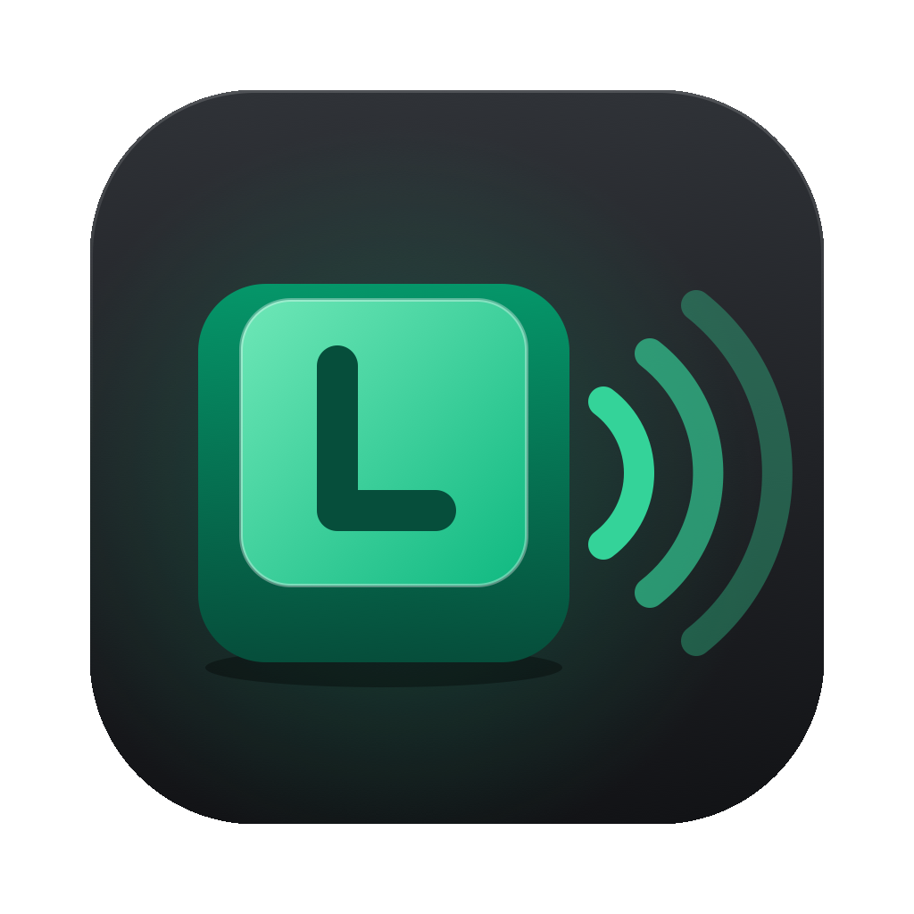

<p align="center">
    
</p>

<h1 align="center">Larakey</h1>

<p align="center">
    Mechanical keyboard and mouse sounds, everywhere you type.<br>
    Free and open source, for macOS, Windows and Linux. Built with Laravel and NativePHP.
</p>

---

Larakey lives in your menu bar (macOS) or system tray (Windows) and plays mechanical keyboard
and mouse sounds as you type and click, in every app.

## Features

- **12 keyboard switch packs**: Classic Mechanical, Creamy Linear, Tactile Brown, Clicky Blue,
  Box Jade, Buckling Spring, Low Profile, Silent Linear and four Keychron-style packs
  (K Red, K Brown, K Blue, Q Thock)
- **4 mouse click packs**: Classic Mouse, Gaming Mouse, Heavy Click and Muted Mouse
- **Per-key sounds**: space, enter, backspace and modifier keys each sound different, with
  stabilizer rattle on the big keys
- **Key release sounds** and **natural pitch variation**, so fast typing never sounds robotic
- **Global shortcut** to mute and unmute: `Cmd+Shift+K` on macOS, `Ctrl+Shift+K` on Windows
- **Launch at login**
- **Low latency**: sounds are decoded once and played with the Web Audio API
- **Private**: Larakey only sees *which kind* of key was pressed, never what you type. Nothing
  is recorded, stored or sent anywhere.

## Download

Get the latest version from the [**Releases page**](../../releases/latest).

| Platform | File |
|---|---|
| macOS (Apple Silicon: M1, M2, M3…) | `Larakey-x.x.x-arm64.dmg` |
| macOS (Intel) | `Larakey-x.x.x-x64.dmg` |
| Windows (64-bit) | `Larakey-x.x.x-setup.exe` |
| Linux: Debian, Ubuntu, Mint… (64-bit) | `larakey_x.x.x_amd64.deb` |
| Linux: Debian, Ubuntu, Mint… (ARM64) | `larakey_x.x.x_arm64.deb` |
| Linux: any distribution (64-bit) | `Larakey-x.x.x-x64.AppImage` |
| Linux: any distribution (ARM64) | `Larakey-x.x.x-arm64.AppImage` |

## Installation

Larakey is free and **not code-signed** (signing costs money every year). Your operating system
will warn you the first time you open it. That warning is expected.

### macOS

1. Open the `.dmg` and drag **Larakey** into **Applications**.
2. Open Larakey. If macOS says *"Larakey can't be opened"* or *"Larakey is damaged"*, open
   **Terminal** and run:

   ```bash
   xattr -cr /Applications/Larakey.app
   ```

   Then open Larakey again. Alternatively, go to **System Settings → Privacy & Security**,
   scroll down and click **Open Anyway**.
3. **Grant Accessibility access.** Larakey needs it to hear your keyboard and mouse outside its
   own window. When prompted, open **System Settings → Privacy & Security → Accessibility** and
   switch **Larakey** on. Sounds start within a few seconds.

> **After updating on macOS:** macOS may forget the Accessibility permission for unsigned apps.
> If the sounds stop after an update, select Larakey in the Accessibility list, remove it with
> the **−** button, then add it again with **+**.

### Windows

1. Run `Larakey-x.x.x-setup.exe`.
2. If you see *"Windows protected your PC"*, click **More info**, then **Run anyway**.

### Linux

**Debian, Ubuntu, Linux Mint and other Debian-based distributions** (recommended):

```bash
sudo apt install ./larakey_x.x.x_amd64.deb
```

**Any other distribution:** make the AppImage executable, then run it:

```bash
chmod +x Larakey-x.x.x-x64.AppImage
./Larakey-x.x.x-x64.AppImage
```

On Ubuntu 24.04 and later, AppImages of Electron apps can be blocked by Ubuntu's AppArmor
restrictions. If the AppImage won't start, use the `.deb` instead.

#### Wayland (the default on Ubuntu, Fedora and Debian)

Wayland doesn't let apps see keyboard and mouse input from other windows. On Wayland,
Larakey reads your input devices directly instead, which needs your account to be in the
`input` group:

```bash
sudo usermod -aG input $USER
```

Then **log out and back in**. Larakey's Settings window shows a reminder if it can't read your
devices. Being in the `input` group lets any program you run read input devices, so only do
this if you're comfortable with that. On **X11** sessions, none of this is needed.

#### Tray icon on GNOME

GNOME hides tray icons by default. Install the
[AppIndicator and KStatusNotifierItem Support](https://extensions.gnome.org/extension/615/appindicator-support/)
extension (preinstalled on Ubuntu) to see Larakey's icon. Most other desktops show it
out of the box.

## Usage

- Click the **Larakey icon** in the menu bar or system tray to:
  - turn **Keyboard Sounds** on or off
  - open **Settings…**
  - **Quit**
- Press `Cmd/Ctrl + Shift + K` anywhere to mute or unmute. On Linux with Wayland, this needs a
  desktop that supports global shortcuts (the GlobalShortcuts portal), which may ask you to
  allow it the first time.
- In **Settings**, pick a keyboard pack and a mouse pack, set the volume and choose your
  options. Changes apply instantly, and you can try them in the **Try it** box.

## Updates

- **Windows:** Larakey checks for updates automatically and installs them when you quit.
- **macOS:** automatic updates require a signed app, so download each new version from the
  [Releases page](../../releases) and replace the app in Applications. Your settings are kept.
- **Linux:** the AppImage updates itself. For the `.deb`, download the new version and install
  it over the old one with the same `apt install` command.

## Development

### Requirements

- PHP 8.3+ and Composer
- Node.js 22+ and npm

### Setup

```bash
git clone https://github.com/codingwithrk/larakey.git
cd larakey
composer install
cp .env.example .env
php artisan key:generate
npm install
npm run build
```

### Run

```bash
composer native:dev
```

On macOS, grant Accessibility access to the development Electron app when prompted.

### Tests

```bash
php artisan test --compact
node --test 'nativephp/electron/src/main/larakey/**/*.test.js'
```

### How it works

| Part | Location |
|---|---|
| Settings window, tray menu, global shortcut | Laravel: `app/`, `resources/views/` |
| Sound engine: audio playback and Linux autostart | Electron: `nativephp/electron/src/main/larakey/` |
| Input on macOS, Windows and Linux X11: global hook ([uiohook-napi](https://github.com/SnosMe/uiohook-napi)) | `nativephp/electron/src/main/larakey/input/uiohook.js` |
| Input on Linux Wayland: input devices (`/dev/input`), read in a utility process | `nativephp/electron/src/main/larakey/input/evdev-*.js` |
| Sound pack recipes | `config/larakey.php` |
| Generated sound packs | `public/sounds/keyboard/` and `public/sounds/mouse/` |

Laravel saves settings to NativePHP's settings store. The Electron sound engine watches that
store and applies changes immediately. Key events never pass through PHP, which keeps latency low.

> **Important:** the sound engine lives inside the published NativePHP Electron project.
> `composer update` runs `native:install --force --publish`, which overwrites
> `nativephp/electron`. Commit your work before updating dependencies and restore
> `nativephp/electron/src/main/larakey/`, the `startLarakey(app)` call in
> `nativephp/electron/src/main/index.js` and the `uiohook-napi` dependency if they are replaced.

### Sound packs

All sounds are synthesized (modal synthesis). There are no recordings, so there are no licensing
concerns. To tweak a pack or add a new one, edit its recipe in `config/larakey.php` and regenerate:

```bash
php artisan larakey:generate-sounds
```

You can also add your own recorded pack: create a folder under `public/sounds/keyboard/` or
`public/sounds/mouse/` containing WAV files and a `pack.json` manifest in the same format as the
generated packs.

## Releasing

Every push to `main` runs the **Tests** workflow (code style and the test suite). Releases are
never automatic. A release is only offered when the tests pass **and** the version has changed,
and it only goes ahead after a maintainer approves it.

1. Bump `NATIVEPHP_APP_VERSION` in `.env.example`, for example `1.0.0` → `1.1.0`, and push to
   `main`.
2. Once the tests pass, the **Release** workflow pauses with **Review deployments**. Open it from
   the **Actions** tab, or from the notification email.
3. **Approve** to build the macOS (Apple Silicon and Intel) and Windows installers and publish
   them as `v1.1.0`, or **Reject** to skip.

Pushes that don't change the version never offer a release, and failing tests never offer one.
Builds are unsigned.

**One-time setup:** go to **Settings → Environments → New environment**, name it `release`, enable
**Required reviewers** and add yourself. The release workflow refuses to run without this
protection.

To build locally instead, set `GITHUB_TOKEN` (with `repo` scope) in `.env`, then run
`php artisan native:publish mac` on a Mac or `php artisan native:publish win` on Windows.

## Contributing

Contributions are welcome! Read [CONTRIBUTING.md](CONTRIBUTING.md) for setup, coding standards and
how to submit sound packs and pull requests.

## Security

Please report vulnerabilities privately. See [SECURITY.md](SECURITY.md). Never open a public issue
for a security problem.

## Disclaimer

The "Keychron-style" packs are synthesized imitations of the general sound character of those
keyboards. Larakey is not affiliated with or endorsed by Keychron, and contains no Keychron
recordings. All trademarks belong to their respective owners.

## License

Larakey is open-source software licensed under the [MIT license](LICENSE).
